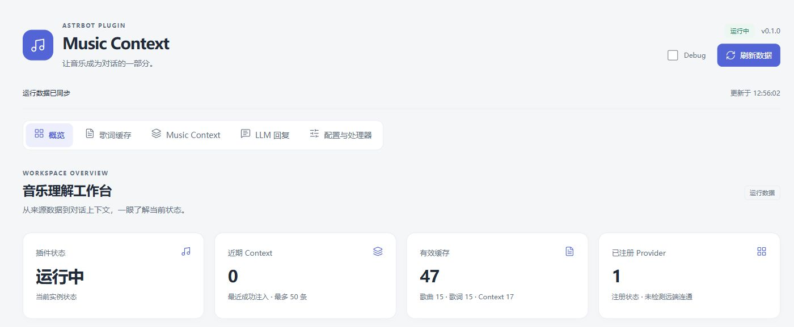
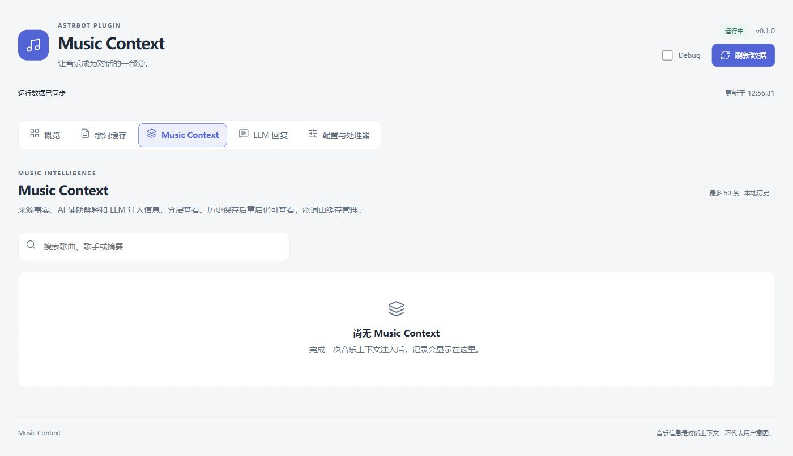
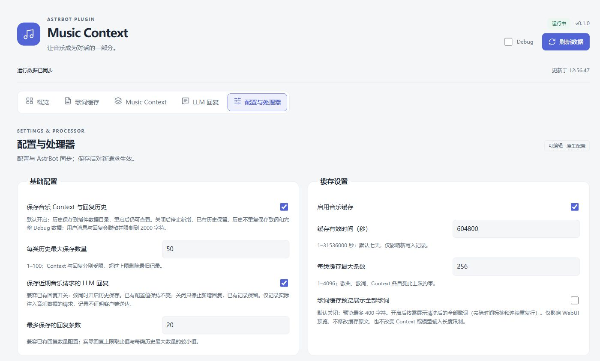

# 听懂这首歌 (Music Context)

**版本：v1.0.1 正式版**

听懂这首歌 (Music Context) 是 AstrBot 音乐上下文插件。解析音乐分享内容，获取歌曲信息与歌词，让 AI 理解并参与关于歌曲的交流。

## 为什么需要听懂这首歌 (Music Context)

普通音乐分享通常只包含歌曲名称、链接等基础信息。听懂这首歌 (Music Context) 补充歌曲信息、可获取的歌词与翻译，作为 AI 对话的上下文，供模型参考用户正在讨论的音乐内容。

插件不提供音乐播放、下载或推荐功能。

## 功能特点

- **音乐分享识别**：解析网易云单曲链接、App 短链及已知 JSON/XML 音乐分享卡片。
- **歌曲信息获取**：获取歌曲名称、歌手、专辑与来源信息。
- **歌词处理**：获取原歌词和可用翻译，清理时间标签、空行与连续重复行；缺少歌词时保留歌曲信息。
- **Music Context 生成**：将歌曲与歌词整理为有长度预算的结构化上下文。
- **Context Processor**：使用选定的 AstrBot 文本模型生成可选辅助解释，默认关闭，失败回退。
- **LLM 回复增强**：临时补充音乐上下文，由 AstrBot 原有模型生成回复；音乐处理失败时普通聊天继续。
- **历史记录**：保存 Music Context 和关联回复记录，支持重载、重启后查看；音乐缓存独立管理。
- **WebUI 管理**：提供概览、歌词缓存、Music Context、LLM 回复、配置与处理器五页，支持浅色/深色和响应式布局。

## 界面展示

以下为插件 WebUI 界面截图，具体功能说明见图片标注。

**Dashboard · 运行概览**



**Music Context · 上下文记录**



**配置页面 · 历史与缓存**



## 安装方式

- AstrBot：`>=4.24.0,<5`（与 `metadata.yaml` 一致）。
- Python：跟随 AstrBot 官方要求。

### AstrBot 插件安装

在插件管理中选择「安装插件 → 从链接安装」，填入仓库地址：

```text
https://github.com/QAZcyang/astrbot-plugin-music-context
```

此方式使用仓库默认分支。需要固定 v1.0.1 时使用下面的 Release 安装或指定 Tag 的手动安装。入口名称以宿主版本为准，参见 [AstrBot 插件安装指南](https://docs.astrbot.app/use/plugin.html)。

### Release 安装

从 [Releases](https://github.com/QAZcyang/astrbot-plugin-music-context/releases) 选择 **v1.0.1**，阅读版本说明并下载 `astrbot_plugin_music_context-v1.0.1.zip`，通过 AstrBot「从文件安装」加载。也可下载对应源码归档，解压后按手动方式安装完整插件根目录。升级前备份原插件、原生配置与插件数据目录。

### 手动安装

在 AstrBot 实际工作目录的 `data/plugins/` 下执行，取得仓库默认分支：

```sh
git clone --depth 1 https://github.com/QAZcyang/astrbot-plugin-music-context.git astrbot_plugin_music_context
```

保留完整插件目录，包括 `main.py`、`metadata.yaml`、`_conf_schema.json`、`src/`、`pages/dashboard/`、`logo.png`、`assets/icon.png`、`LICENSE`、`NOTICE.md` 和图标 notices。已有安装请先备份插件、配置与数据。

安装后在 AstrBot 中加载/重载并检查日志，在目标会话的插件列表中启用听懂这首歌 (Music Context)。正常分享支持的单曲链接，并确保会话会触发 LLM 请求；无需音乐命令。管理页入口为插件详情的 **Pages/页面 → dashboard**。更多使用边界见[使用与开发指南](USER_GUIDE.md)。

确认 Dashboard 显示 `v1.0.1`，分享网易云单曲链接后查看新增 Music Context；有音乐关联的模型回调时可查看 LLM 回复。记录表示 Hook 观察，最终消息送达仍以客户端为准。版本内容与限制见 [v1.0.1 Release 说明](https://github.com/QAZcyang/astrbot-plugin-music-context/releases/tag/v1.0.1)。

## 配置说明

AstrBot 原生插件配置与 Dashboard「配置与处理器」共用配置文件。Dashboard 保存后对新请求生效，原生配置保存后按宿主流程重载。

| 分组 | 主要配置 | 用途 |
| --- | --- | --- |
| Provider | 自动注册网易云数据源 | 当前无需选择音乐 Provider；新增平台按下方接口扩展 |
| 卡片消息 | `enable_card_parser` | 控制内置音乐卡片解析，默认开启 |
| Cache | `enable_cache`、`cache_ttl`、`max_cache_items` | 控制音乐缓存开关、有效期与容量 |
| Context | `enable_context_injection`、`max_context_length` | 控制音乐上下文注入与长度预算 |
| Processor | `enable_context_processor`、`processor_model` | 从 AstrBot 已配置文本模型的下拉框选择处理器模型 |
| History | `history_enable`、`max_history_items`、`store_llm_history`、`llm_history_limit` | 控制 Context 与关联回复的保存和容量 |
| Debug | `debug_mode` | 按需查看原始诊断信息，默认关闭 |

Processor 默认关闭；开启后会调用选定模型，可能产生费用。辅助分析是歌曲文本推断，不是已核实知识。历史可能包含对话内容，请妥善保管；管理页面向已登录的 WebUI 管理员。

配置默认值、歌词预览、生成参数、历史存储与隐私细节见[使用与开发指南](USER_GUIDE.md)，全部配置以 [`_conf_schema.json`](_conf_schema.json) 为准。

### 卡片消息解析

`enable_card_parser` 默认开启；旧配置缺少此字段时也使用 `true`。
启用后，插件会主动解析音乐卡片消息，并沿用 Provider → Context → LLM 流程。

如果同时使用其他音乐卡片解析插件，可能有多个插件处理同一消息。
如出现重复回复或重复解析，可以关闭此选项，并交由其他插件处理。
关闭后听懂这首歌 (Music Context) 跳过 JSON/XML 卡片，不为卡片补充文本或生成音乐 Context；
普通文本音乐链接仍正常处理，AstrBot 原有聊天流程继续。该选项不调整事件优先级，
也不自动处理多插件冲突。Dashboard 保存后对新请求生效，重启后保持保存值。

## 开发扩展

### 项目结构

```text
src/astrbot_plugin_music_context/
  parser/        音乐候选、链接标识与短链解析
  providers/     音乐检索、Provider 注册与能力路由
  models/        统一数据模型
  lyrics/        歌词清洗
  context/       Context Builder 与可选 Processor
  cache/         音乐缓存与历史存储
  integration/   AstrBot 交互与上下文注入
  webui/         管理状态与宿主接口
pages/dashboard/ 原生静态管理界面
```

### 架构设计

```text
Music Provider
      ↓
数据标准化 / 歌词清洗
      ↓
Context Builder
      ↓
Context Processor（可选）
      ↓
LLM Context Injection → AstrBot 原有对话模型
```

链接识别与缓存复用发生在检索前；Provider 获取原始数据，Builder 不联网，并在注入前控制最终预算。新贡献者可先阅读[中文代码架构说明](docs/REFERENCE.md)，再查看[架构设计](docs/REFERENCE.md)和[处理器设计](docs/REFERENCE.md)。

### 添加新的音乐平台支持

1. 实现 `MusicProvider`，声明唯一名称与实际能力，提供本地链接识别及资源获取。
2. 返回统一的 `MusicTrack` / 原始 `MusicLyrics`，保证平台与歌曲身份一致。
3. 通过 `ProviderRegistry.register()` 注册，或使用包内 `discover()` 发现具体实现。
4. 添加 Provider、路由与集成测试，补充来源/API/许可记录，完成真实平台 API 验证后再更新支持状态。

Provider 只负责音乐数据获取，不生成 Context、不调用 LLM。完整接口、注册示例和开发验证入口见[Provider Registry](docs/REFERENCE.md)、[能力路由](docs/REFERENCE.md)与[使用与开发指南](USER_GUIDE.md)。

## 支持的平台

| 平台 | 状态 | 说明 |
| --- | --- | --- |
| 网易云音乐 | 已支持 | 获取单曲信息、原歌词与可用翻译 |
| QQ 音乐 | 接口预留 | 尚无具体 Provider 实现 |
| 其他平台 | 欢迎贡献（接口预留） | 通过现有 Provider 契约扩展，尚无具体实现 |

**预留接口未经过真实平台 API 测试。** Reserved interfaces have not been tested with real platform APIs.

QQ 聊天中的网易云分享卡片不等于 QQ 音乐数据源支持。卡片是否触发 LLM 由宿主唤醒与预处理流程决定，支持范围见[使用指南](USER_GUIDE.md)。

网易云 Provider 使用标准库直接请求歌曲详情与歌词接口，不依赖 NeteaseCloudMusicApi 服务。接口来源、参数与使用边界见 [API 清单](docs/REFERENCE.md)。

## 贡献指南

欢迎贡献新 Provider、Bug 修复、WebUI 优化与文档改进。

- **Issue**：通过[问题入口](https://github.com/QAZcyang/astrbot-plugin-music-context/issues)提供版本、预期/实际行为和最小复现；日志与截图请移除凭据、私人标识、聊天正文和歌词内容。
- **Pull Request**：Fork 仓库并创建工作分支，关联问题/任务，说明改动与验证结果，更新相关文档；提交前核对目标分支与维护者说明，使用[PR 入口](https://github.com/QAZcyang/astrbot-plugin-music-context/pulls)提交。
- **Provider 贡献**：按上面的接口扩展音乐数据源。架构、依赖、外部服务或破坏性变更先与维护者讨论，并遵循[持续开发规则](docs/REFERENCE.md)。

## 致谢

特别感谢 [jjf1126/astrbot_plugin_ncm_get](https://github.com/jjf1126/astrbot_plugin_ncm_get)，为项目提供早期 AstrBot 音乐插件方向与音乐信息获取探索的参考。

在这一方向的启发下，听懂这首歌 (Music Context) 独立扩展了 Provider 抽象、Context 生成、临时 LLM 上下文注入、WebUI 管理和历史持久化。这里是思路参考与社区学习的致谢，不表示复制了参考项目代码；具体来源与授权另行追踪。

也感谢 [AstrBot](https://github.com/AstrBotDevs/AstrBot) 维护者与生态社区提供插件接口和交流基础。完整参考范围见[来源清单](docs/REFERENCE.md)。

## 开源许可

项目自有代码与文档采用 **[MIT License](LICENSE)**，Copyright (c) 2026 QAZcyang。

第三方资源、宿主与依赖遵循各自许可证或条款。音乐元数据、歌词、翻译及平台服务不因项目采用 MIT 而取得分发授权；许可边界见[许可审查](docs/REFERENCE.md)。

## 第三方声明

见根目录 **[NOTICE.md](NOTICE.md)**。Dashboard 图标保留 Lucide ISC 与适用的 Feather MIT notices，随包保留[图标来源说明](pages/dashboard/assets/icons/NOTICE.md)和[完整上游许可证](pages/dashboard/assets/icons/LICENSE.txt)。

详细记录：[来源清单](docs/REFERENCE.md)、[API 清单](docs/REFERENCE.md)、[依赖审查](docs/REFERENCE.md)。发行材料范围见[发行内容政策](docs/REFERENCE.md)，更多文档见 [docs/](docs/)。
